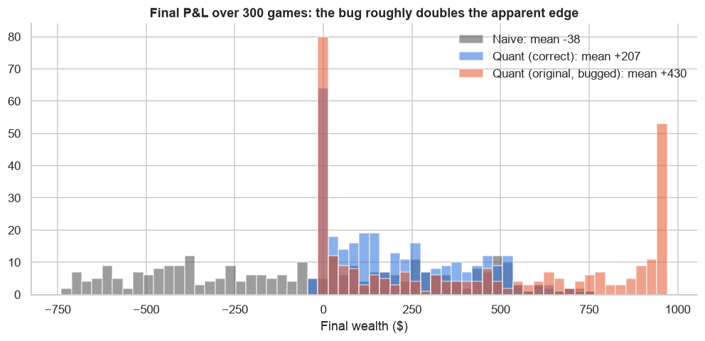

# Quant Guild Study

Re-implementing and extending the [Quant Guild Library](https://github.com/romanmichaelpaolucci/Quant-Guild-Library) (Roman Paolucci's quant finance lectures) as a set of self-contained Jupyter notebooks, using **only freely available data**.

Each notebook rebuilds a lecture's idea from scratch and then pushes it further: bug-checking the original, adding statistical tests, and taking the simulation to real market data (equities, FX, volatility).


<sub>From project 01: a look-ahead bug in a simple adaptive strategy roughly doubles its apparent edge.</sub>

## Projects

| # | Project | Key result | Data |
|---|---|---|---|
| 01 | [How to Trade: all models are wrong, some are useful](notebooks/01_how_to_trade/how_to_trade.ipynb) | Finds a look-ahead bug that doubles a strategy's apparent edge. On SPY and EUR/USD, a rolling hit-rate signal does no better than random timing (p ≈ 0.8–0.9). | Simulation, Yahoo Finance |

The full learning path (8 modules, ~80 lectures) is in **[ROADMAP.md](ROADMAP.md)**.

## How I'm studying

A 20-week plan at 2 hours a day ([study plan PDF](study/Study_Plan.pdf)). Each project starts as a notebook of tasks with self-checking checkpoints. I write the code, then extend the idea on real data. Progress is in the [learning log](study/LEARNING_LOG.md).

## Run it yourself

```bash
git clone https://github.com/giomil1998/quant-guild-study.git
cd quant-guild-study
python3 -m venv .venv && source .venv/bin/activate
pip install -r requirements.txt && pip install -e .
python -m ipykernel install --user --name quant-guild-study
jupyter lab
```

Market data downloads on first run and is cached in `data/` (git-ignored).

## Layout

```
notebooks/NN_topic/   one folder per project, numbered in roadmap order
src/qgs/              shared helpers: free data loader (with cache), plot style, checkpoints
assets/               headline figures used in this README
study/                study plan (PDF + generator) and learning log
ROADMAP.md            lecture-by-lecture learning path and progress
```

## Free data sources

- **Yahoo Finance** via `yfinance`: equities, ETFs, FX spot (`EURUSD=X`), indices (`^VIX`), current option chains
- **FRED**: rates, macro, credit spreads
- **Ken French Data Library**: factor returns for the portfolio modules

## Credit

The concepts and lecture structure come from Roman Paolucci's [Quant Guild Library](https://github.com/romanmichaelpaolucci/Quant-Guild-Library) and the accompanying YouTube lectures. The code and extensions in this repository are my own, written independently. This project is not affiliated with Quant Guild.
